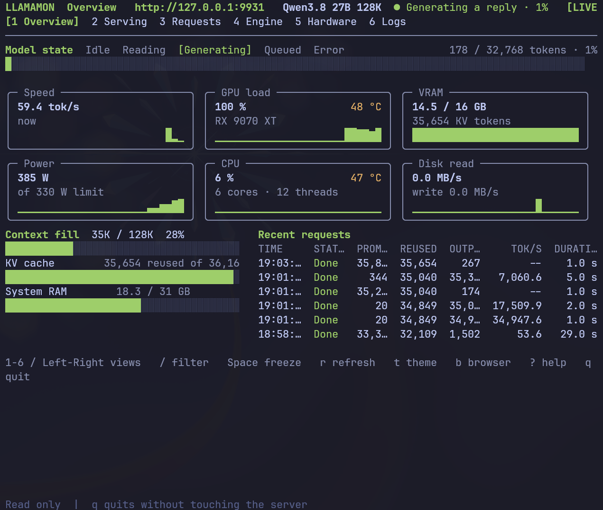

# llamamon

A lightweight terminal monitor for a local [llama.cpp](https://github.com/ggml-org/llama.cpp)
inference server: what the model is doing right now, how fast it generates, how much of the
context is in use, and what the host machine is doing under it.

llamamon watches one server — `http://127.0.0.1:9931` by default — and draws a one-screen
dashboard in the spirit of the [Strata Monitor](https://github.com/Niko1221/Strata). It is
**read-only**: it only reads the server's status endpoints and never sends it anything.



## Contents

- [Why llamamon?](#why-llamamon)
- [Features](#features)
- [Requirements](#requirements)
- [Installation](#installation)
- [Quick start](#quick-start)
- [Command reference](#command-reference)
- [The dashboard](#the-dashboard)
- [Keyboard shortcuts](#keyboard-shortcuts)
- [Themes](#themes)
- [Configuration](#configuration)
- [Where the numbers come from](#where-the-numbers-come-from)
- [Troubleshooting](#troubleshooting)
- [Development](#development)
- [License](#license)

## Why llamamon?

When you run a local model you keep asking the same questions: is it busy, and how fast is it
generating? Is the context window filling up? Is the GPU getting hot?

llama.cpp has no built-in dashboard — its endpoints (`/props`, `/slots`, `/health`) are raw JSON
made for scripts. llamamon turns them into a live one-screen view: the model's state, generation
speed, context and KV-cache usage, recent requests, and the host's GPU, CPU, RAM and disk
activity.

## Features

- A one-screen **Overview** dashboard: a model-state bar, six sparkline tiles (speed, GPU load,
  VRAM, power, CPU, disk), bars for context fill, KV-cache reuse and system RAM, and the recent
  requests. Multi-GPU machines get a per-card strip as well.
- Six views: Overview, Serving, Requests, Engine, Hardware, Logs.
- A connection marker: `LIVE`, `STALE`, `CONNECTING`, `DISCONNECTED`, `FROZEN`.
- Read-only by design: watching never sends the server anything, and quitting leaves it untouched.
- `status` and `config` run on the standard library alone — no pip packages needed for a snapshot.
- Four themes: `dark`, `light`, `terminal`, `tokyonight`.
- One small TOML config file (`~/.config/llamamon/config.toml`); command-line flags override it.
- Host hardware sampling with graceful fallbacks: anything unreadable is drawn as `--`, never a
  made-up zero.

## Requirements

- **Python 3.11 or newer** (the config reader uses the standard library's `tomllib`).
- A reachable llama.cpp server; the default `http://127.0.0.1:9931` works out of the box.
- **`rich` and `textual`** for the full-screen monitor. `status` and `config` do not need them.
- Optional host-metric tools (each adds its metrics when present):
  - `psutil` — CPU load, RAM, disk read/write (a plain `/proc` fallback works without it);
  - `nvidia-smi` (NVIDIA) or `rocm-smi` (AMD) — GPU load, temperature, power, VRAM;
  - `sensors` (lm_sensors) — the CPU's own temperature.

Hardware metrics depend on your host operating system and which of these tools are installed;
missing values are shown as `--`.

## Installation

Pick the method that fits you.

**pip, from a source checkout**

```bash
python -m pip install /path/to/llamamon
```

This installs the `llamamon` command itself.

**The optional monitor packages** (from a source checkout):

```bash
python -m pip install -r llamamon/requirements.txt    # rich, textual, psutil
```

`status` and `config` work without these. If `rich` or `textual` is missing, the `monitor`
command refuses to start, prints this hint, and exits with code `4`.

**From a source checkout, no install**

```bash
git clone https://github.com/sentakuhm/llamamon
# from the folder that contains the checkout:
python -m llamamon status
python llamamon/llamamon.py status
```

**Prebuilt binaries** from the [v1.1.1 release](https://github.com/sentakuhm/llamamon/releases/tag/v1.1.1):

- Debian/Ubuntu: `llamamon_1.1.1_all.deb` (depends on `python3`; suggests `python3-rich`,
  `python3-textual`, `python3-psutil`)
- Arch Linux: `llamamon-1.1.1-1-x86_64.pkg.tar.zst` (depends on `python-rich`, `python-textual`,
  `python-psutil`)
- Source zip: `llamamon-1.1.1-src.zip`

Verify any installation with:

```bash
llamamon --version    # llamamon 1.1.1
```

## Quick start

1. Make sure your llama.cpp server is running. The default is `http://127.0.0.1:9931`.
2. Point llamamon at it if it lives elsewhere (optional):

   ```bash
   llamamon config set url http://127.0.0.1:8080
   ```

   or just for one run: `llamamon status --port 8080`.
3. Launch the monitor:

   ```bash
   llamamon
   ```

   You should see the Overview: a model-state bar (Idle / Reading / Generating / Queued / Error),
   six sparkline tiles, context / KV-cache / RAM bars, and the recent requests.
4. Explore with `1`–`6` (views), `?` (shortcut list), and quit with `q`. The server is never
   touched.

If you only need a snapshot:

```bash
llamamon status
```

## Command reference

| Command | What it does |
| --- | --- |
| `llamamon` | The full-screen monitor (the default) |
| `llamamon status` | One snapshot, printed as plain text |
| `llamamon config show` | The settings as they take effect |
| `llamamon config set <key> <value>` | Change one setting (validated before saving) |
| `llamamon config path` | Print the config file's path |
| `llamamon config init` | Write the defaults to the config file |
| `llamamon config help` | Where the file lives and how to change it |
| `llamamon --version` | Print `llamamon 1.1.1` |

Flags (they apply to `monitor` and `status`, and override the config file):

| Flag | Meaning |
| --- | --- |
| `--url URL` | The server root (an http/https root only) |
| `--port PORT` | Shorthand for `http://127.0.0.1:PORT` |
| `--interval SECS` | Seconds between polls (0.2–60, default `1.0`) |
| `--timeout SECS` | Seconds one HTTP request may take (0.5–30, default `4.0`) |
| `--requests N` | Recent requests the views keep (1–50, default `12`) |
| `--theme T` | `dark`, `light`, `terminal`, `tokyonight` (or `auto`) |
| `--color C` | `auto`, `always`, `never` (the `NO_COLOR` environment variable forces `never`) |
| `--glyphs G` | `auto`, `unicode`, `ascii` (`auto` picks unicode when the terminal can encode it) |

Exit codes: `status` exits `0` on success, `2` on a bad URL, `3` when the server cannot be
reached. `monitor` exits `4` when `rich`/`textual` are missing from the interpreter.

## The dashboard

Six views, switched with `1`–`6` or `←`/`→`:

| View | What you see |
| --- | --- |
| **Overview** | The model-state bar, six tiles with sparklines (Speed, GPU load, VRAM, Power, CPU, Disk read), bars for context fill, KV cache and system RAM, and the recent requests. |
| **Serving** | One row per server slot: what it is reading, how much of the prompt has been read, how much is cached, how many tokens are written, what remains, and the current tok/s. |
| **Requests** | Finished requests, newest first: prompt / reused / output token counts, mean tok/s, duration — plus what is running right now. |
| **Engine** | The model, its file, context capacity, slot count, the llama.cpp version, and which extra endpoints the server exposes. |
| **Hardware** | The GPU card(s), PCIe link, GPU load / power / VRAM / temperature, CPU, RAM and disk rates — labelled with where the numbers came from. |
| **Logs** | The activity this monitor itself observed (requests finishing, decoding bursts). |

A few terms, in plain language:

- **tok/s** — how fast the model writes tokens (generation). While the prompt is still being
  read, the Speed tile shows the prompt-read rate instead.
- **Context fill** — the prompt plus the tokens generated so far, measured against the server's
  context capacity.
- **KV cache** — prompt tokens the server kept in its KV cache and reused instead of reading
  again.
- **GPU load / temperature / power / VRAM** — the host's graphics card, measured with
  `nvidia-smi` or `rocm-smi`.
- **Status marker** — `LIVE` (a fresh sample), `STALE` (a request is running and some builds
  delay the monitor's own reads — or the last sample is more than a few seconds old),
  `CONNECTING`, `DISCONNECTED`, and `FROZEN` (the display is frozen while collection continues).

## Keyboard shortcuts

| Key | Action |
| --- | --- |
| `1`–`6` | Jump to a view |
| `←` / `→` | Previous / next view |
| `t` | Cycle theme (terminal → dark → light → tokyonight) |
| `Space` | Freeze / unfreeze the display (collection continues) |
| `r` | Refresh immediately |
| `/` | Filter the recent requests (Enter applies, Esc clears) |
| `b` | Open the server root in a browser |
| `?` or `F1` | Show the shortcut list |
| `q` or `Ctrl+C` | Quit |

## Themes

| Theme | Look |
| --- | --- |
| `dark` | The original dark palette |
| `light` | The original light palette |
| `terminal` | Your terminal's own colours |
| `tokyonight` | The Tokyo Night palette (`#1a1b26` background, `#c0caf5` text, `#7aa2f7` blue, `#f7768e` red, `#9ece6a` green, `#e0af68` yellow) |

Set `theme` in `config.toml` (`auto` means `terminal`) or switch at runtime with `t`.

## Configuration

One file: `~/.config/llamamon/config.toml`. Create it with `llamamon config init`, edit it by
hand, or change a single setting with `llamamon config set`.

| Key | Default | Meaning / allowed values |
| --- | --- | --- |
| `url` | `http://127.0.0.1:9931` | The server root — an http(s) root without a path, query, fragment or credentials; remote hosts must use `https` |
| `interval` | `1.0` | Seconds between polls (0.2–60) |
| `timeout` | `4.0` | Seconds one HTTP request may take (0.5–30) |
| `requests` | `12` | Recent requests the views keep (1–50) |
| `theme` | `dark` | `auto` (terminal), `dark`, `light`, `terminal`, `tokyonight` |
| `color` | `auto` | `auto`, `always`, `never` (`NO_COLOR` forces `never`) |
| `glyphs` | `auto` | `auto`, `unicode`, `ascii` |

Example:

```toml
# ~/.config/llamamon/config.toml
url = "http://127.0.0.1:9931"
interval = 1.0
timeout = 4.0
requests = 12
theme = "tokyonight"
color = "auto"
glyphs = "auto"
```

The file overrides the built-in defaults, and command-line flags override the file. Unknown keys
are kept, so a hand-edited file round-trips; a file that fails to parse prints a warning and the
defaults are used instead.

## Where the numbers come from

llamamon never invents a value: unknown readings are drawn as `--`.

- **From the server** — the model's facts (`/props`), per-slot activity (`/slots`), health
  (`/health`), and the model file behind the alias (`/v1/models`). Some llama.cpp forks also
  answer `GET /metrics` with their own live state, series and request log; when that endpoint
  exists, its numbers take priority over the monitor's samples.
- **From the host machine** — the GPU (via `nvidia-smi` or `rocm-smi`), the CPU's temperature
  (via `sensors`), and CPU / RAM / disk (via `psutil`, or a plain `/proc` fallback). These
  describe the machine llamamon runs on — if the server is remote, they are *not* the server's
  hardware. The Hardware view and `status` say so explicitly: `reported by the server` versus
  `sampled from this machine`.
- **Reconstructed by the monitor** — the sparkline series, the rates, and the request history.
  Plain llama.cpp keeps no history of its own, so llamamon builds these from its own successive
  polls. A timed-out poll is a gap in the series, never a zero, and a request that finishes
  within one poll interval may not be recorded; the tok/s shown for a request is a mean over the
  samples the monitor saw.

## Troubleshooting

- **`status` exits with 3 / the monitor shows `DISCONNECTED`** — the server is not reachable at
  that URL. Check that the server is up and that `url` (or `--url` / `--port`) points at its
  root; `llamamon status` is the quickest probe.
- **`STALE` while a request is running** — expected on some builds: they delay the monitor's own
  reads behind a running request. It clears by itself, and the last good sample stays on screen.
- **`--` in a tile or row** — that reading is unavailable: a tool is missing (no
  `nvidia-smi` / `rocm-smi` / `sensors` / `psutil`), the server did not report it, or (for CPU
  load) it is the very first sample. The host-to-GPU PCIe transfer rate is `--` unless the
  server's `/metrics` reports it — the host sampler cannot measure it.
- **`monitor` refuses to start (exit 4)** — `rich` and `textual` are not installed in that
  interpreter. Install them (`python -m pip install -r llamamon/requirements.txt` from a source
  checkout); `status` and `config` keep working without them.
- **`config set url` rejects the URL** — it must be an http(s) server root with no path, query,
  fragment or credentials, and remote hosts require `https`.
- **The layout looks cramped** — the Overview scales with the window: below 62 columns the six
  tiles go two-across, and as the window shrinks the recent requests, the multi-GPU cards
  strip, the hint line and the blank lines drop out first, the bars stay. In a short window
  the layout becomes compact — two-line tiles without the sub line, one-line bars, and the
  state names shortened — so the same window shows more rows and all five model states stay
  visible. (The terminal's font size is set by the terminal emulator, not by llamamon; the
  compact layout is what llamamon can do.) Only when even that smallest layout no longer fits
  (roughly 64 columns × 18 rows for the three-across tiles, or 43 columns × 22 rows for the
  two-across tiles) is the plain-text view drawn instead.
- **A warning about `config.toml`** — a file that does not parse as TOML falls back to the
  defaults with a stderr warning. Check the effective settings with `llamamon config show`.

## Development

The repository is one flat Python package (see `pyproject.toml`). From a checkout you can run it
directly, no install needed:

```bash
python -m llamamon status
python llamamon/llamamon.py monitor
```

There is no test suite or CI in the repository at present; changes are verified by running the
tool against a live server. Release packaging exists: a `PKGBUILD` for Arch (`makepkg -f` inside
a checkout) and the `.deb` built for the release.

## License

MIT — see [LICENSE](LICENSE).

- [Source](https://github.com/sentakuhm/llamamon)
- [Releases](https://github.com/sentakuhm/llamamon/releases)
- [Issues](https://github.com/sentakuhm/llamamon/issues)
- [Changelog](CHANGELOG.md)
